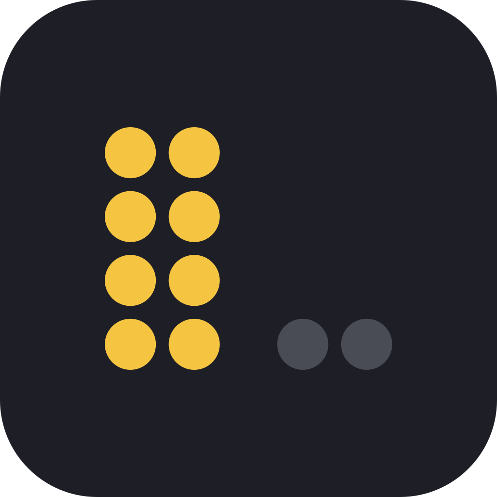
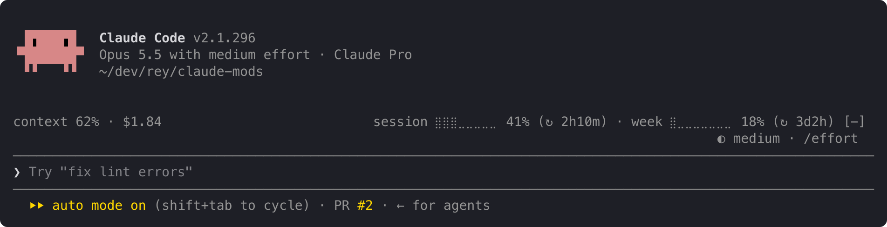
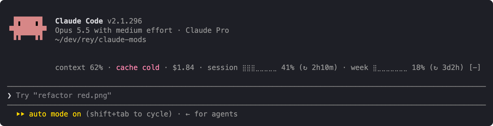
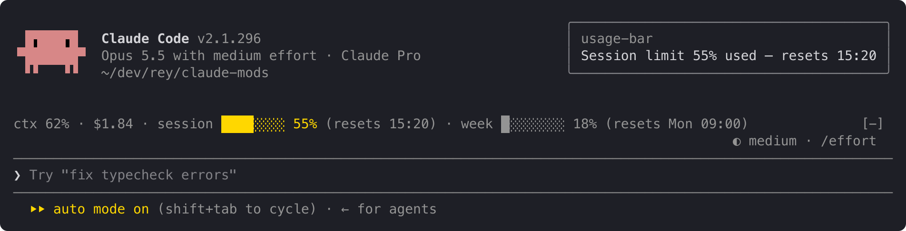
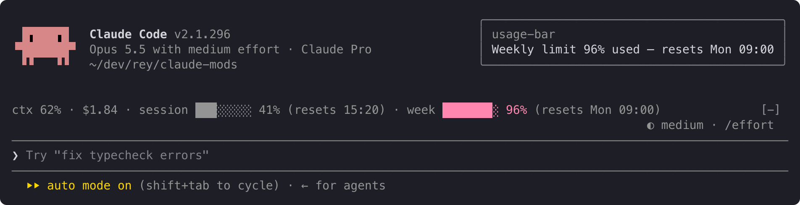

#  usage-bar

Your plan's usage limits, context and cost on one quiet line above the prompt, with an alert before you run out. It doesn't replace your status line: it sits above the prompt, so the two work side by side.



The line sits at the right edge, away from where you read and type. From left to right:

| On the line | What it shows |
|---|---|
| `context` | How full this conversation's context window is. |
| `cache cold` | In red: the conversation's cache has expired, so your next message re-reads all of it at full price. |
| `$` | What this session has cost. |
| `session`, `week` | How much of your 5-hour and weekly limits you've used. After `↻`, how long until each resets: `2h10m`, `3d2h`, or `now`. |

More on `cache cold`:

- It works right after `/resume` too, before you send anything.
- It shows only for conversations of 100,000 tokens or more. Change that size, or turn it off, in `/config`.
- It doesn't notice a cache broken by switching models, but `/model` warns you about that itself.



## Alerts

A limit's percent turns yellow at 75% and red at 90%, as on claude.ai's usage page; the rest of the line stays grey. An alert with the limit and its percent appears at the top right at 50%, 75% and 90%:





When both limits cross at once, one alert names both: `session 62% · week 97%`. Each alert shows once per limit period, even across restarts and projects. When a limit resets, its alerts start over.

## When the line doesn't fit

The line at the top is the full layout. When it doesn't fit, it shortens instead of wrapping, one step at a time:

```
ctx 62% · $1.84 · s ⣿⣿⣿⣀⣀⣀⣀⣀ 41% (↻ 2h10m) · w ⣿⣀⣀⣀⣀⣀⣀⣀ 18% (↻ 3d2h)
```

```
ctx 62% · $1.84 · s 41% (↻ 2h10m) · w 18% (↻ 3d2h)
```

```
ctx 62% · $1.84 · s 41% · w 18%
```

## Before the first reading

For a few seconds after startup, and for as long as you're not logged in, the line reads:

```
usage: no data yet
```

The context shows `–` until your first reply, because Claude Code measures the context only when it answers.

In the desktop app, a new session and `/clear` show no line at all until you send a message: the app starts Claude Code only then.

## What it is not

- **Not a status line.** It sits above the prompt and leaves your status line alone.
- **Not a usage history.** It shows the current figures and nothing over time.

## Privacy

- **Reads only what Claude Code already has:** context fill, session cost and your plan's limits.
- **Sends nothing.** It makes no network requests, and nothing it reads leaves your machine.
- **Stores one small record per limit** on your machine, noting which usage alerts it has shown, so restarting Claude Code doesn't show the same alert twice.
- **Starts one program:** `tail -c 262144 <conversation file>` after each reply and on `/resume` or `/branch`, to read the last 256 KiB of this conversation's file and learn whether the cache lasts `5m` or `1h`. It keeps only that value.
- **Hooks session start and compaction** only to reset its own saved figures when you `/clear`, `/resume` or compact. It changes no settings, instructions, tool calls or other hooks.

## Install

In Claude Code:

```
/plugin install usage-bar --marketplace andrej-kolic/claude-mods
```

The desktop app's Code tab doesn't offer `/plugin install`: run it once in a terminal, at the user scope, and the line shows in the desktop app's local sessions too.

- **Claude Code:** 2.1.275 or later for this one-step install. Tested on 2.1.295 and 2.1.296 in the terminal, and in the desktop app 2.31226.0.
- **Plan:** usage limits need a Claude subscription. With an API key, the line shows only the context and `$`, and no alerts.
- **Context cost:** about 0 tokens. It adds nothing to what Claude reads.
- **Where it shows:** Claude Code's terminal and the desktop app's Code tab. The VS Code extension's chat panel doesn't show it yet. It does nothing on claude.ai or in Cowork.
- **Windows:** tested on macOS only. In Windows 10's older console window, the bars and symbols show as empty boxes; in Windows Terminal and the desktop app they show correctly. On Windows, `cache cold` can show too early after `/resume` when you use an API key.

## More

The screenshots use sample readings. The yellow and red follow your Claude Code theme.

The [spec](https://github.com/andrej-kolic/claude-mods/blob/main/docs/usage-bar.md) has every rule: rounding, colours, widths, and when alerts repeat.
